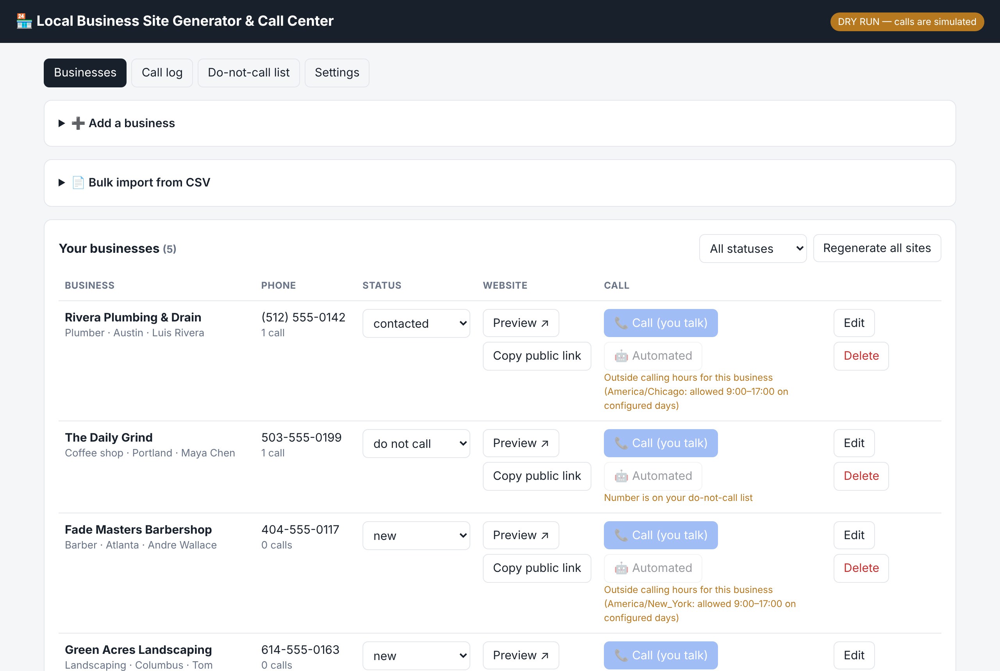

# Local Business Site Generator + Call Center

Give it a list of local businesses. It builds each one a professional, mobile-friendly website, then helps you **call them** to pitch it, all from one dashboard.



| Plumber | Café | Mobile |
|---|---|---|
|  |  |  |

It has **no dependencies**. You only need Node.js 18 or newer.

## Quick start

```bash
cp .env.example .env      # fill in your details (works without Twilio in dry-run mode)
npm start                 # → http://localhost:3000
```

1. **Add businesses** one at a time with the form, or paste or upload a CSV (see `examples/businesses.csv`).
2. A website is generated right away for each business. Click **Preview** to see it.
3. Click **📞 Call (you talk)** to phone the business.

To generate sites only, without the dashboard, run:

```bash
npm run generate -- examples/businesses.csv     # or a .json file
# → output/sites/<business-slug>/index.html
```

## The website generator

- It detects the business type from the category (restaurant, café, plumber/HVAC/trades, auto, salon/barber, dental/medical, landscaping, cleaning, gym, retail, or general). Each type gets its own colors, fonts, wording, default services and trust badges.
- If you only know the name, phone and city, it writes a tagline, description and services for you.
- Each site is a single self-contained HTML file. It includes a click-to-call button, a sticky call bar on phones, a Google Map, opening hours, SEO meta tags and `LocalBusiness` structured data for Google.
- When you edit a business, its site is regenerated.
- Sites are served at `/sites/<slug>/`. If `PUBLIC_URL` is set, you can copy a public link to send to the owner. The `output/sites` folder can also be uploaded as-is to Netlify, Vercel, GitHub Pages or any web host.

## The call center

Calls go through [Twilio](https://www.twilio.com). It costs about 1–2¢ a minute and you need a Twilio phone number. Until you add Twilio keys, everything runs in **dry-run mode**: calls are logged but never dialed.

There are two call modes:

| Mode | How it works | Needs |
|---|---|---|
| **📞 Call (you talk)**, the "bridge" mode | Twilio rings **your** phone first. When you pick up, it dials the business and you pitch them live. The business sees your Twilio number. | `OWNER_PHONE` |
| **🤖 Automated** | Twilio calls the business and plays a short pitch: *Press 1 to talk to you now, press 2 to get the preview link by text, press 9 to never be called again.* If an answering machine picks up, it leaves a voicemail with your callback number. | `PUBLIC_URL` **and** the business's consent (see below) |

All calls are listed in the **Call log** with status, outcome and key presses. Lead statuses update automatically (e.g. pressing 1 marks the business *interested*), and you can set them yourself: new → contacted → interested / callback / not interested → won.

### Calling rules (built in, to keep you out of trouble)

Cold-calling businesses is legal in most places, but robocall laws are strict. In the US, the TCPA and FCC rules treat AI and text-to-speech voices as "artificial voices", and fines are **$500–$1,500 per call**. The app enforces these rules:

- **Automated calls are blocked unless the business is marked "gave consent".** Only tick that box if they actually agreed, e.g. they filled in a form or said yes on an earlier call. For cold outreach, use the **bridge** mode, where you are the one talking.
- **Do-not-call list.** Anyone who presses 9, or that you mark *do not call*, is never called again.
- **Calling hours** use the *business's* local time zone (default Mon–Fri, 9am–5pm).
- **No hammering.** By default a business gets at most 3 attempts, at least 24 hours apart.
- Automated calls say up front that they're automated, name who is calling, and offer an opt-out. Texts include "Reply STOP".

You are still responsible for following the laws where you call. That includes scrubbing your list against the [National Do Not Call Registry](https://telemarketing.donotcall.gov/) if you call any sole proprietors on personal or cell numbers, and following your state's rules. This isn't legal advice.

### Going live with Twilio

1. Create a Twilio account, buy a phone number, and copy the **Account SID** and **Auth Token**.
2. Fill in `.env`: `TWILIO_ACCOUNT_SID`, `TWILIO_AUTH_TOKEN`, `TWILIO_FROM_NUMBER`, `OWNER_PHONE`, `DRY_RUN=0`.
3. Bridge calls now work right away.
4. For automated calls, preview links and live call status, the server must be reachable on the internet:
   - testing: `ngrok http 3000`, then set `PUBLIC_URL=https://<your-id>.ngrok-free.app`
   - production: deploy to Render, Railway, Fly.io or a VPS and set `PUBLIC_URL` to that address.

   Twilio webhooks are checked with Twilio's request signatures.

## Project layout

```
src/generator.js   website templates + per-industry presets
src/callcenter.js  calling rules, call scripts (TwiML), Twilio API
src/server.js      dashboard API, Twilio webhooks, serves generated sites
src/cli.js         bulk generate from CSV/JSON
public/index.html  dashboard
data/db.json       your businesses, calls, do-not-call list (created on first run)
output/sites/      generated websites
```

Run the tests with `npm test`.
