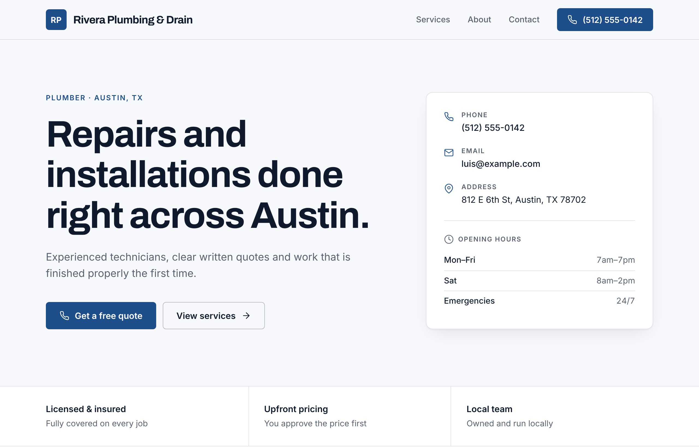
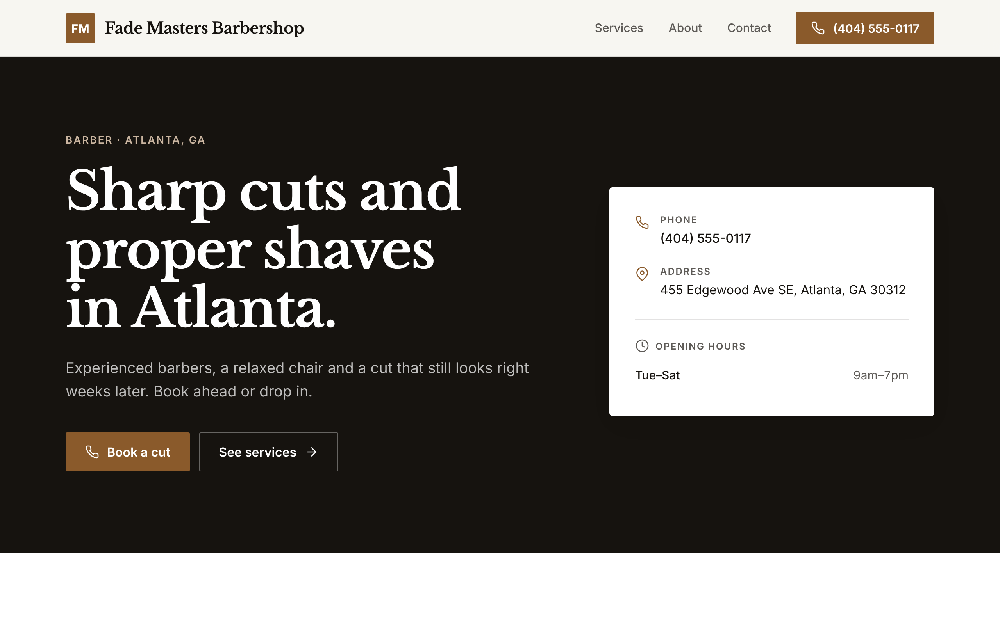
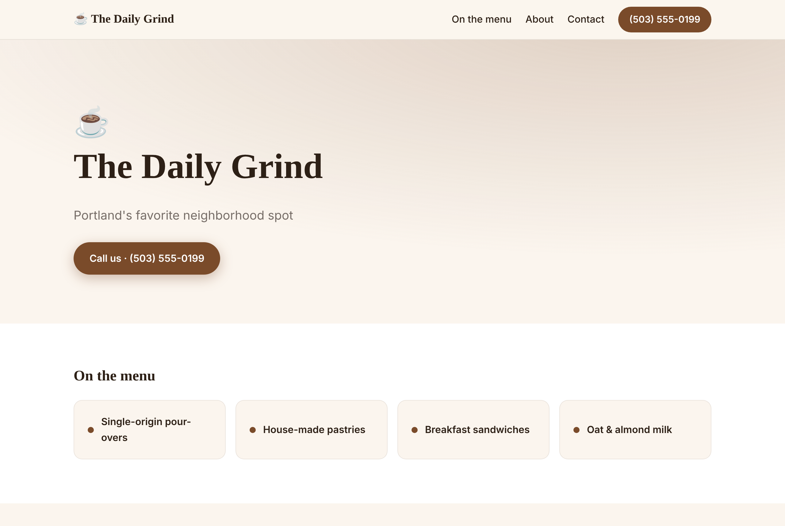
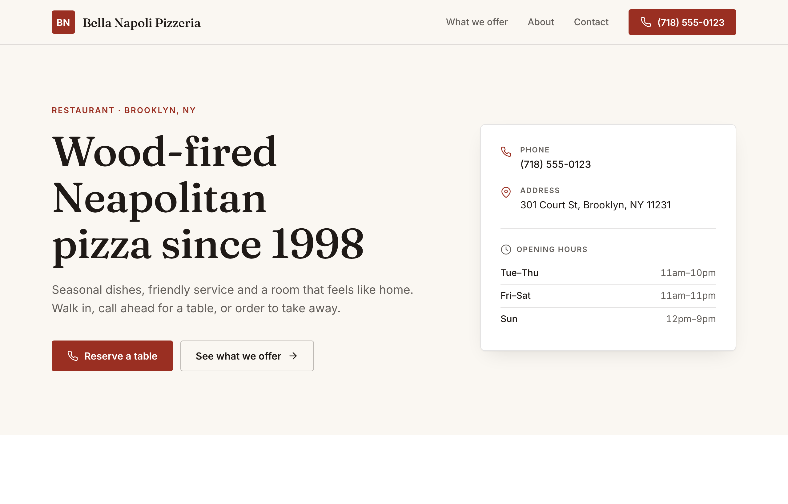
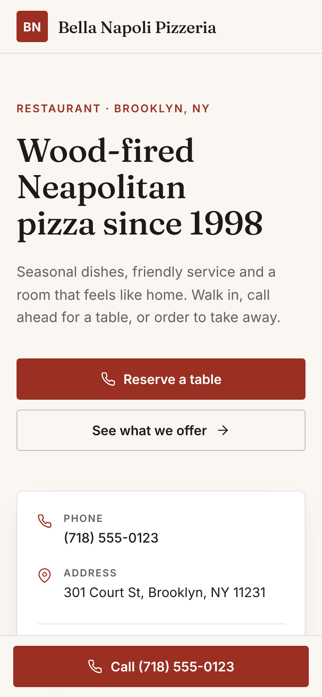

# Local Business Site Generator + Call Center

Give it a list of local businesses. It builds each one a professional, mobile-friendly website, then helps you **call them** to pitch it, all from one dashboard.


| Plumber | Barber |
|---|---|
|  |  |
| **Café** | **Restaurant** |
|  |  |



It has **no dependencies**. You only need Node.js 18 or newer.

## Just want the website generator?

Open **[`dist/website-generator.html`](dist/website-generator.html)** in any browser. It's a single file, with no install and no server. Type in a business, or import a CSV, and watch the live preview. Then download one site as HTML, or all of them as a .zip. Businesses you save stay in that browser.

The file is built from the same code as the app, so the sites are identical. Run `npm run build:html` to rebuild it after changing `src/generator.js`.

## Quick start

```bash
cp .env.example .env      # fill in your details (works without Twilio in dry-run mode)
npm start                 # → http://localhost:3000
```

1. **Add businesses** one at a time with the form, or paste or upload a CSV (see `examples/businesses.csv`).
2. A website is generated right away for each business. Click **Preview** to see it.
3. Click **Call (you talk)** to phone the business.

To generate sites only, without the dashboard, run:

```bash
npm run generate -- examples/businesses.csv     # or a .json file
# → output/sites/<business-slug>/index.html
```

## The website generator

- **Designed per industry.** The category picks one of 12 design presets: restaurant, café, trades (plumber, electrician, HVAC, roofing…), auto, barber, salon & spa, dental/medical, landscaping, cleaning, fitness, retail, and general. Each preset has its own font pairing, color palette, layout details and copy.
- **Professional by default.** Every site has real web typography (Google Fonts), line icons instead of emoji, a numbered services list, a contact card with opening hours, a trust strip for trades and services, a call-to-action band and a full footer. All color palettes are tested to pass WCAG AA contrast.
- **Works from very little.** With only a name, phone number and city, it writes a natural headline, intro, services and About text. Supply your own `tagline`, `description` or `services` to override any of them. Services can include a description: `Leak repair: Same-day fixes for any leak`.
- **Photos.** Add a `photo` column with an image URL and it is used in the hero. Without one, the hero shows the contact and hours card.
- **Ready for phones and Google.** Phone layout with a sticky call button, click-to-call links, SEO meta tags and `LocalBusiness` structured data. A map and a "Get directions" button appear when there is a street address.
- **One self-contained HTML file per site.** Sites are served at `/sites/<slug>/`. You can also upload the `output/sites` folder to Netlify, Vercel, GitHub Pages or any web host.

> **Before you send a preview,** check the default wording with the owner. Phrases such as "Licensed & insured" or "Free estimates" are placeholders, so make sure they're true for that business, or edit them in the dashboard.

## The call center

Calls go through [Twilio](https://www.twilio.com). It costs about 1–2¢ a minute and you need a Twilio phone number. Until you add Twilio keys, everything runs in **dry-run mode**: calls are logged but never dialed.

There are two call modes:

| Mode | How it works | Needs |
|---|---|---|
| **Call (you talk)**, the "bridge" mode | Twilio rings **your** phone first. When you pick up, it dials the business and you pitch them live. The business sees your Twilio number. | `OWNER_PHONE` |
| **Automated** | Twilio calls the business and plays a short pitch: *Press 1 to talk to you now, press 2 to get the preview link by text, press 9 to never be called again.* If an answering machine picks up, it leaves a voicemail with your callback number. | `PUBLIC_URL` **and** the business's consent (see below) |

All calls are listed in the **Call log** with status, outcome and key presses. Lead statuses update automatically (e.g. pressing 1 marks the business *interested*), and you can set them yourself: new → contacted → interested / callback / not interested → won.

### Calling rules (built in, to keep you out of trouble)

Cold-calling businesses is legal in most places, but robocall laws are strict. In the US, the TCPA and FCC rules treat AI and text-to-speech voices as "artificial voices", and fines are **$500–$1,500 per call**. The app enforces these rules:

- **Automated calls are blocked unless the business is marked "gave consent".** Only tick that box if they actually agreed, e.g. they filled in a form or said yes on an earlier call. For cold outreach, use the **bridge** mode, where you are the one talking.
- **Do-not-call list.** Anyone who presses 9, or that you mark *do not call*, is never called again.
- **Calling hours** use the *business's* local time zone (default Mon–Fri, 9am–5pm).
- **No hammering.** By default a business gets at most 3 attempts, at least 24 hours apart.
- Automated calls say up front that they're automated, name who is calling, and offer an opt-out. Texts include "Reply STOP".

You are still responsible for following the laws where you call. That includes scrubbing your list against the [National Do Not Call Registry](https://telemarketing.donotcall.gov/) if you call any sole proprietors on personal or cell numbers, and following your state's rules. This isn't legal advice.

**Calling in Canada.** The CRTC's Unsolicited Telecommunications Rules apply:
- Calls to businesses are exempt from the National Do Not Call List (DNCL), but you must still keep your own do-not-call list and honor requests within 14 days. The app handles this automatically.
- If you call any sole proprietor on a personal or residential line, you need to register with the [National DNCL](https://lnnte-dncl.gc.ca/) and check numbers against it.
- Automated or pre-recorded sales calls (ADAD rules) need the person's prior express consent, so use **Call (you talk)** for cold outreach.
- Allowed hours are weekdays 9am–9:30pm and weekends 10am–6pm. The defaults (Mon–Fri, 9am–5pm) stay inside those.
- Identify yourself and who you're calling for at the start of each call.

### Test call to your own phone

Hear exactly what businesses will hear before you call anyone. In the dashboard, go to **Settings → Test call to my phone**, or run:

```bash
npm run test-call -- +15551234567     # defaults to OWNER_PHONE
```

This needs Twilio keys, but it works even with `DRY_RUN=1`, because it only ever calls you. Key presses on a test call never change a lead's status or the do-not-call list.

### Going live with Twilio

1. Create a Twilio account, buy a phone number, and copy the **Account SID** and **Auth Token**.
2. Fill in `.env`: `TWILIO_ACCOUNT_SID`, `TWILIO_AUTH_TOKEN`, `TWILIO_FROM_NUMBER`, `OWNER_PHONE`, `DRY_RUN=0`.
3. Bridge calls now work right away.
4. For automated calls, preview links and live call status, the server must be reachable on the internet:
   - testing: `ngrok http 3000`, then set `PUBLIC_URL=https://<your-id>.ngrok-free.app`
   - production: deploy to Render, Railway, Fly.io or a VPS and set `PUBLIC_URL` to that address.

   Twilio webhooks are checked with Twilio's request signatures.

## Project layout

```
src/generator.js   website templates + per-industry presets
src/callcenter.js  calling rules, call scripts (TwiML), Twilio API
src/server.js      dashboard API, Twilio webhooks, serves generated sites
src/cli.js         bulk generate from CSV/JSON
public/index.html  dashboard
data/db.json       your businesses, calls, do-not-call list (created on first run)
output/sites/      generated websites
```

Run the tests with `npm test`.
